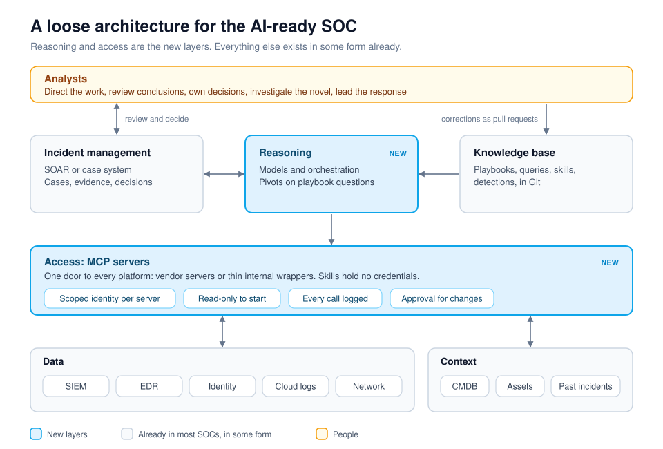

*Part 4 of Building the AI-Ready SOC series*

*Codified knowledge, capable analysts and good models only work together if the platform around them is safe, observable and affordable.*

The first three posts covered [how to think about AI in the SOC](https://www.infosecuriosity.co.uk/posts/2026-06-28-Most-SOCs-Are-Thinking-About-AI-the-Wrong-Way/), [what to codify](https://www.infosecuriosity.co.uk/posts/2026-08-02-Codification-The-Missing-Foundation-of-the-AI-Ready-SOC/), and [how the analyst's role changes](https://www.infosecuriosity.co.uk/posts/2026-10-15-The-Future-SOC-Analyst/) and how to develop the people who fill it. This post covers the platform that connects the knowledge to your tools, and the decisions that determine whether it stays safe and affordable.

This should be approached iteratively, starting small and building up.

## The Platform in Five Layers

Three of the layers probably exist already, in some form:

- Data: your SIEM, cloud logs, EDR and identity platforms.
- Incident management: the system of record for cases, evidence and decisions, whether that is your SOAR or a case management platform.
- Knowledge base: playbooks, queries, detections and skills. Some of this exists today in wikis, runbooks and analysts' heads, but it needs to be in a form AI can use, which is what the second post covered.

Two are new:

- Reasoning: the models, and the orchestration around them that decides what to ask them.
- Access: MCP servers, which give the model controlled reach into everything else. Everything the model touches goes through here.

Playbooks are generic, so the AI also needs context about your environment. Some comes from your own history, such as previous incidents and how they were resolved. The rest comes from contextual sources such as the CMDB, asset inventory and identity platform. Both are queried through the access layer like any other tool, which keeps environment detail out of the playbooks.

## One Alert Through the Platform

Take the PowerShell alert from the last post. It arrives in the SOAR, which opens the case. The orchestration layer pulls the relevant playbook questions from the knowledge base. The model uses them as something to pivot on, using its skills to choose the queries and parameters that answer each question, such as the host, user, IP address or time window, and following the evidence where it leads. Each query runs through an MCP server against the right platform: process history from the EDR, sign-ins from the identity platform, outbound connections from network logs. The model also asks for context, such as what the host does, who owns it and whether similar alerts have been seen before. The results come back summarised, the model writes its reasoning and recommendation into the case, and an analyst reviews it. Every step is logged against the case.

## One Door: MCP

The first post argued that embedded AI sees only its own platform, an NDR tool seeing only network data for example. MCP is how one investigation reaches across all of them. All connectivity goes through it, either a vendor's server or a thin internal wrapper over your own APIs.

That gives you one place to enforce scope, rate limits and logging, and replacing a platform means changing a server without rewriting every skill. Each server should use its own scoped identity, and the [MCP specification](https://modelcontextprotocol.io/specification/latest/basic/security_best_practices) forbids token passthrough, so one shared, over-privileged token never undoes that scoping.

Skills hold know-how: which query to choose, how to fill in its parameters and how to make sense of the results. They never hold credentials or connection details. Those live in the MCP servers, so a skill can be reviewed, shared and version controlled without exposing access to anything.

## Guardrails

AI will sometimes be wrong. It can be misled by the data it reads, because attackers write some of that data: a command line, a user agent or an email body can contain text meant to instruct a model. A query that silently returns nothing can close an investigation falsely, which is why generated queries are reviewed before they join the library. It can do harm if it has more access than the job needs. People are a risk too, because the more reliable the AI looks, the less carefully it gets checked, as covered in [the last post](https://www.infosecuriosity.co.uk/posts/2026-10-15-The-Future-SOC-Analyst/).

Plan for all of these. Start read-only, give each connection the least privilege it needs, log every question, query and result against the case, and require a person to approve anything that changes state.

## Models and Cost

Reasoning is where model quality matters most. A frontier model is one option, and a smaller or cheaper model may be good enough for some alert categories. Choose on evidence by testing candidates against your own golden set, described below. Prices change often enough that any figure here would be out of date, so the useful part is knowing what drives your own bill.

Cost follows how much you put in front of the model, so the size of query results matters as much as alert volume. Four controls help:

- A query budget per investigation, capping how many queries run and how much each returns.
- Aggregation in the query, so the model sees counts and top results and not raw rows. Normalised output fields in your queries help here.
- Caching repeat lookups, such as the same host or hash within and across investigations.
- Routing lighter models to extraction, formatting and summaries, and keeping the most capable model for reasoning and conclusions.

Track cost per investigation from the first week and compare it with your current process and with analyst time. A cost that drifts upward can be an early sign that queries or prompts have changed.

## Proving It Works

The aim is for AI to take on routine investigation reliably enough that analysts can spend their time on more worthwhile things, with a human in the loop. Compare it against your current process, whether that is existing automation or an analyst working the case, to see where it is good enough. To do that, keep a golden set of past investigations with known outcomes, including cases where the current process got it wrong. Run the AI against that set whenever a model, skill or playbook changes, and compare conclusions, evidence completeness, queries used and cost.

In production, the feedback from the last post does the rest. Lessons from analyst reviews go back into the queries, playbook questions and detections, and each correction adds a case to the golden set. A model upgrade is a change like any other and goes through the same test.

## A Practical Path

1. Codify. Playbooks, queries and detections in Git. This is worth doing without any AI, for consistency, audit and onboarding.
2. Assisted triage, read-only. The AI investigates and an analyst reviews every conclusion before closure.
3. Trusted triage. For alert categories that have proven themselves against the golden set, analysts sample the results.
4. Hunting and detection engineering. The AI proposes hypotheses, draft queries and detections, and analysts review them.
5. Containment with approvals. The AI recommends and prepares actions, and a person approves them.

Start with one high-volume alert category to prove the approach. After that, categories that share playbooks and queries can move up together as the evaluation supports it.

## Closing Thoughts

This series has made one argument. The three jobs in a SOC are the certain, the variable and the novel, and each needs the right owner. Codification turns your best people's expertise into something AI can work from. Analysts direct that work, take on the novel and lead the response. The platform keeps all of it safe and measurable.

The future SOC won't be defined by how much AI it buys. It will be defined by how effectively it can transform human expertise into something AI can execute at scale.

Start with the knowledge base. It pays back before any AI is involved, and everything else depends on it.
